# Pier-Olivier Boulianne, the log

I'm building LuxEngine, a C++20 game engine on Vulkan for Windows and Linux, and I keep the work public here. The engine holds most of my source because it's the project I'm still inside; the rest is the tooling around it. I started programming at eleven, in Luau on Roblox.

### The deepest layers

- **[LuxEngine](https://github.com/starbounded-dev/LuxEngine):** C++20 game engine on Vulkan. Deferred clustered PBR, a render graph that skips disabled passes, miniaudio-based spatial audio with "Soundwave" acoustics, Jolt 3D physics and Box2D 2D, C# scripts on .NET 10 with hot reload. Apache-2.0.
- **[crew-emblem-tracer](https://github.com/sheazywi/crew-emblem-tracer):** traces any image into a GTA Online crew emblem you can import straight into Rockstar's emblem editor.
- **[actions-runner-console](https://github.com/sheazywi/actions-runner-console):** local dashboard for the GitHub Actions runners behind LuxEngine's CI, on Linux and Windows.
- **[pi-watchdog](https://github.com/sheazywi/pi-watchdog):** a Raspberry Pi 3B that checks the two Proxmox VMs hosting those runners every 30 seconds and raises alerts through Hermes.

### The career log

- **2020:** joined GitHub in October 2020.
- **2023:** opened the org @starbounded-dev and started building in the open.
- **2024:** sheazywi.github.io, test-dev, archive and OpenGL3D all went up in one year.
- **2025:** q511, a Vite + React + Tailwind app that watches Québec 511's live road cameras from where I live.
- **2026:** three new tools for LuxEngine's CI and a batch of engine work: HZB occlusion fix, tile-grid viewport, sample games, project-format versioning.

[starbounded.com](https://starbounded.com) · [@sheazywi](https://x.com/sheazywi)

---

# What I maintain

| Project | Stack | State |
| --- | --- | --- |
| [LuxEngine](https://github.com/starbounded-dev/LuxEngine) | C++20 · Vulkan · GLSL · C# | Apache-2.0, 90 open issues |
| [crew-emblem-tracer](https://github.com/sheazywi/crew-emblem-tracer) | TypeScript · Canvas | shipped |
| [actions-runner-console](https://github.com/sheazywi/actions-runner-console) | Python · PowerShell · Shell | 2 stars, runs LuxEngine's CI |
| [pi-watchdog](https://github.com/sheazywi/pi-watchdog) | Python · systemd | one 30-second loop over two VMs |
| [q511](https://github.com/sheazywi/q511) | Vite · React · Tailwind · HLS | live road cameras, watching from home |

### How to contribute

1. Pick any open issue on [LuxEngine](https://github.com/starbounded-dev/LuxEngine/issues). That tracker is where the engine's next work is.
2. Work on a branch named `feature/<thing>`, the pattern the repo's own branches follow, and merge into `dev`, the branch the engine lives on.
3. LuxEngine is C++20 on Vulkan. Make it build on Windows or Linux before you open a PR.
4. Anything merged into LuxEngine falls under its Apache-2.0 licence, so read the licence first.

Engine questions go on LuxEngine's issue tracker. Everything else, email me at [sheazywi@starbounded.com](mailto:sheazywi@starbounded.com).

---

| In the engine | Around the engine |
| --- | --- |
| Deferred clustered PBR on Vulkan, Windows and Linux | actions-runner-console watches the CI runners from a local dashboard |
| A render graph that skips disabled passes, so a pass you don't draw costs nothing | pi-watchdog guards the Proxmox VMs hosting those runners every 30 seconds, Hermes alerts |
| miniaudio-based spatial audio, "Soundwave" acoustics | crew-emblem-tracer turns any image into a GTA Online crew emblem |
| Jolt 3D physics and Box2D 2D | q511 watches Québec 511's live road cameras from home over HLS streams |
| C# scripts on .NET 10 with hot reload | this profile repo, CC0, self-hosted SVG banners |

> I've been building in the open since 2023. The engine I keep describing here is unfinished because it's the one I'm still working on.

---

<picture>
  <source media="(prefers-color-scheme: dark)" srcset="https://raw.githubusercontent.com/sheazywi/Sheazywi/output/snake-dark.svg" />
  <source media="(prefers-color-scheme: light)" srcset="https://raw.githubusercontent.com/sheazywi/Sheazywi/output/snake.svg" />
  
</picture>

### Pier-Olivier Boulianne

> *building LuxEngine in the open.*

The snake above is generated fresh every day by an Action in this repo, eating real commits, not props.

[starbounded.com](https://starbounded.com) · [@sheazywi](https://x.com/sheazywi)
