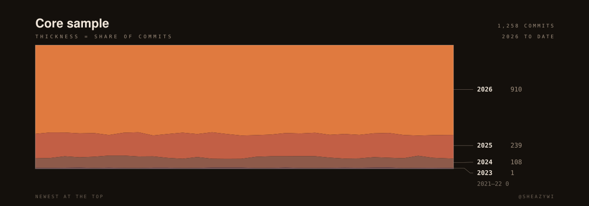

  

  

  

<picture>
  <source media="(prefers-color-scheme: dark)" srcset="https://raw.githubusercontent.com/sheazywi/sheazywi/output/snake-dark.svg" />
  <source media="(prefers-color-scheme: light)" srcset="https://raw.githubusercontent.com/sheazywi/sheazywi/output/snake.svg" />
  
</picture>

  <a href="https://starbounded.com">starbounded.com</a> · <a href="https://github.com/starbounded-dev/LuxEngine">LuxEngine</a> · <a href="https://twitter.com/sheazywi">@sheazywi</a>

