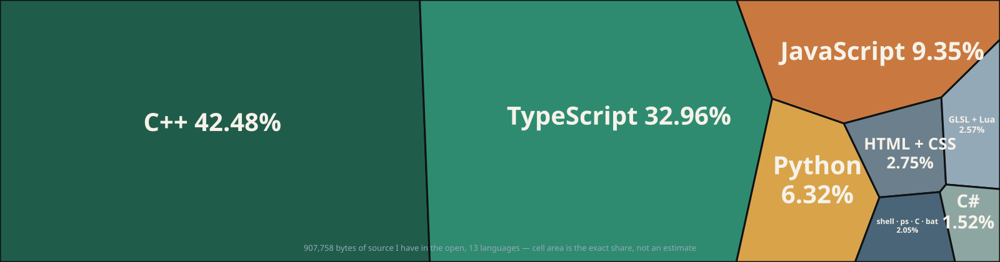

# Pier-Olivier Boulianne — the log

I'm building LuxEngine: a C++20 game engine on Vulkan, Windows and Linux, that I
work on in the open. Most of my source is C++ because the engine is the project I'm
still inside — the rest is the tooling around it. Started programming at eleven, in
Luau on Roblox; what I write today is C++ and Vulkan, but the career didn't start
there.

### The deepest layers

- **[LuxEngine](https://github.com/starbounded-dev/LuxEngine)** — C++20 game engine on Vulkan: deferred clustered PBR, a render graph that skips disabled passes, miniaudio-based spatial audio, Jolt 3D physics and Box2D 2D, C# scripts on .NET 10 with hot reload.
- **[crew-emblem-tracer](https://github.com/sheazywi/crew-emblem-tracer)** — traces any image into a GTA Online crew emblem you can import straight into Rockstar's emblem editor.
- **[actions-runner-console](https://github.com/sheazywi/actions-runner-console)** — local dashboard for the GitHub Actions runners behind LuxEngine's CI, on Linux and Windows.
- **[pi-watchdog](https://github.com/sheazywi/pi-watchdog)** — a Raspberry Pi 3B that checks the two Proxmox VMs running those runners every 30 seconds and alerts through Hermes.

### The career log

- **2020** — joined GitHub, October 2020 — six years now.
- **2023** — started building in the open as @starbounded-dev.
- **2024** — sheazywi.github.io, test-dev, archive and OpenGL3D all went up.
- **2025** — q511, a Vite + React + Tailwind slideshow starter for Québec's route 511.
- **2026** — three new tools for LuxEngine's CI and a batch of engine work: HZB occlusion fix, tile-grid viewport, sample games, project-format versioning.

Started programming at eleven, in Luau, on Roblox. What I write today is C++ and Vulkan, but the career didn't start there.

— [starbounded.com](https://starbounded.com) · [@sheazywi](https://x.com/sheazywi)

---

# What I maintain

| Project | Stack | State |
| --- | --- | --- |
| [LuxEngine](https://github.com/starbounded-dev/LuxEngine) | C++20 · Vulkan · GLSL · C# | GPL-3.0 · 90 open issues |
| [crew-emblem-tracer](https://github.com/sheazywi/crew-emblem-tracer) | TypeScript · Canvas | small and done in the open |
| [actions-runner-console](https://github.com/sheazywi/actions-runner-console) | Python · PowerShell · Shell | 2★ · Linux + Windows runners |
| [pi-watchdog](https://github.com/sheazywi/pi-watchdog) | Python · systemd | monitors two VMs every 30 s |
| [q511](https://github.com/sheazywi/q511) | Vite · React · Tailwind | slideshow starter |

### How to contribute

1. Pick any open issue on [LuxEngine](https://github.com/starbounded-dev/LuxEngine/issues) — that tracker is where the engine's next work is.
2. Work on a branch named `feature/<thing>`, which is what the repo's own workflow uses.
3. Keep commits compiling: LuxEngine is C++20 on Vulkan, so build it on Windows or Linux before opening a PR.
4. PRs to LuxEngine fall under its GPL-3.0 licence, so read it before you commit code.

Questions about the engine go on LuxEngine's issue tracker; everything else, email me at [sheazywi@starbounded.com](mailto:sheazywi@starbounded.com).

---

| The engine | Around the engine |
| --- | --- |
| Deferred clustered PBR on Vulkan, Windows and Linux | actions-runner-console watches the CI runners from a local dashboard |
| A render graph that skips disabled passes, so the frame you don't draw costs nothing | pi-watchdog guards the Proxmox VMs that host those runners, alerting every 30 s through Hermes |
| miniaudio-based spatial audio — "Soundwave" acoustics | crew-emblem-tracer turns any image into a GTA Online crew emblem |
| Jolt 3D physics and Box2D 2D | q511, a Vite + React + Tailwind slideshow starter for Québec's route 511 |
| C# scripts on .NET 10 with hot reload | this profile repo, under CC0, hand-drawn SVGs and all |

> Building in the open since 2023 — the README you're reading is the deepest layer.

---

# The territory

907,758 bytes of source in 13 languages, the banner's cells cut by exact area share:
C++ 42.48%, TypeScript 32.96%, JavaScript 9.35%, Python 6.32%, HTML + CSS 2.75%,
GLSL + Lua 2.57%, shell · PowerShell · C · bat 2.05%, C# 1.52%. C++ owns the map
because LuxEngine is the engine I'm still working on; TypeScript comes second from
the tools that support it.

### What's built with it

- [LuxEngine](https://github.com/starbounded-dev/LuxEngine) — the C++20 / Vulkan engine: renderer, audio, editor, physics, scripting.
- [crew-emblem-tracer](https://github.com/sheazywi/crew-emblem-tracer) — TypeScript, the 298 kB that makes the second cell.
- [actions-runner-console](https://github.com/sheazywi/actions-runner-console) — Python and PowerShell for the self-hosted runners.
- [pi-watchdog](https://github.com/sheazywi/pi-watchdog) — Python, one cron loop.
- [q511](https://github.com/sheazywi/q511) — TypeScript, Vite, React, Tailwind.
- [OpenGL3D](https://github.com/sheazywi/OpenGL3D) — C++ again, the step before Vulkan.
